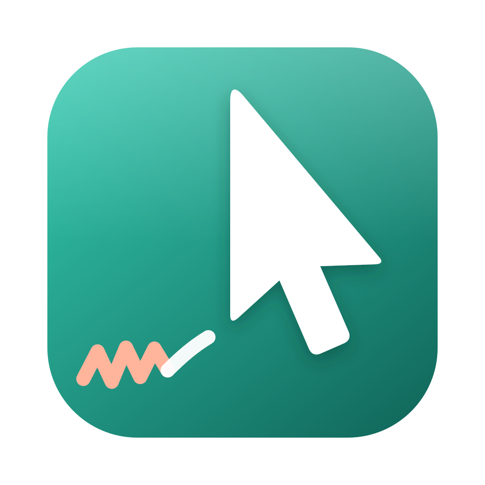
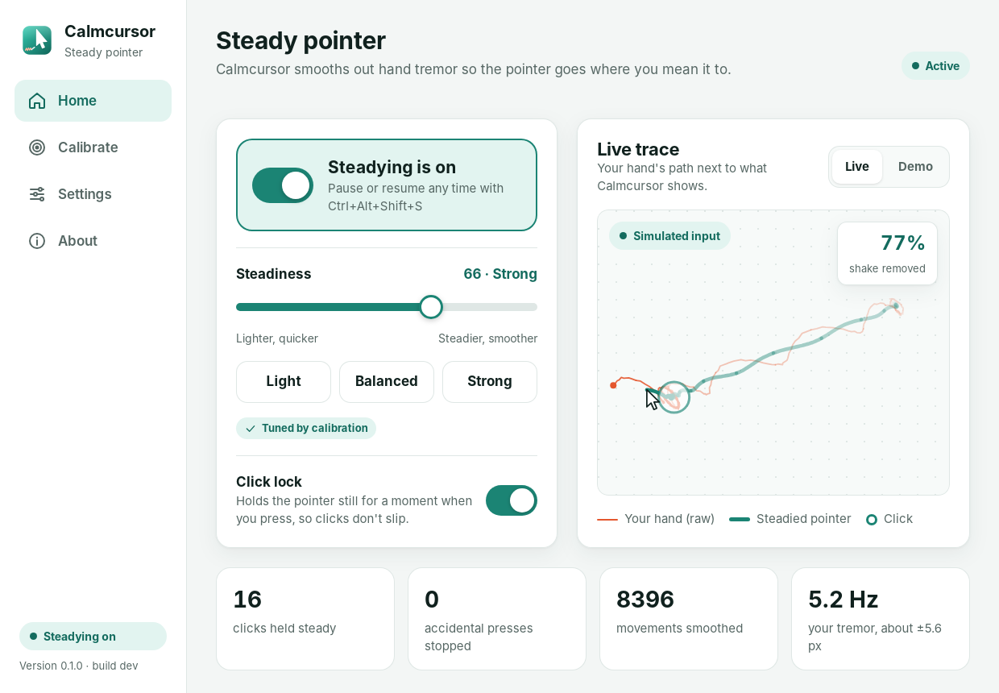
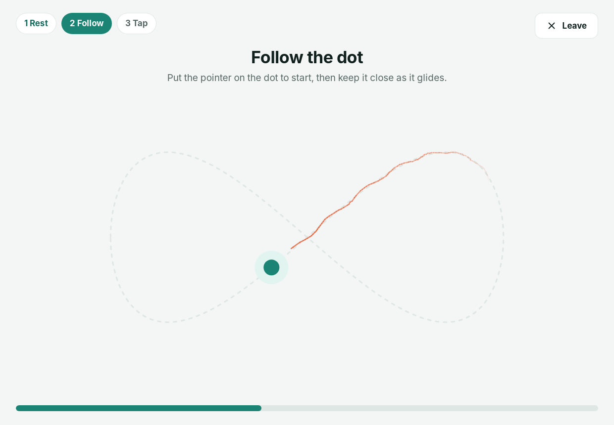
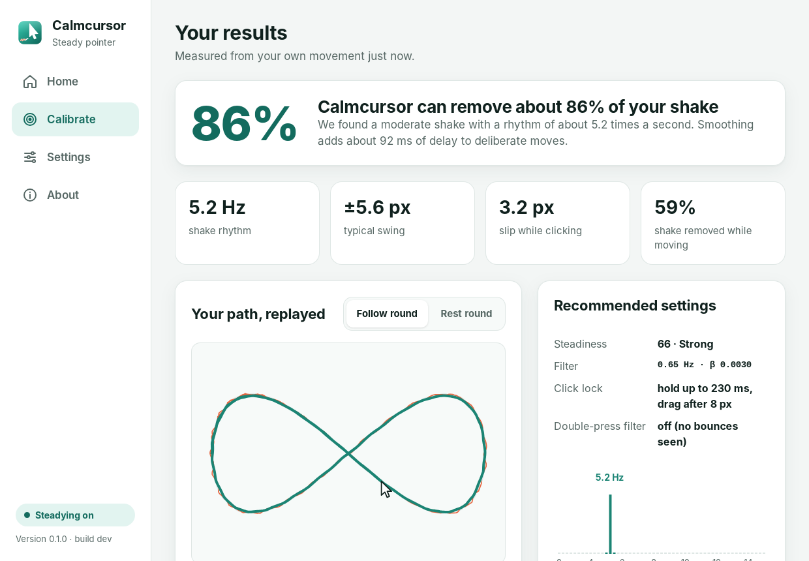
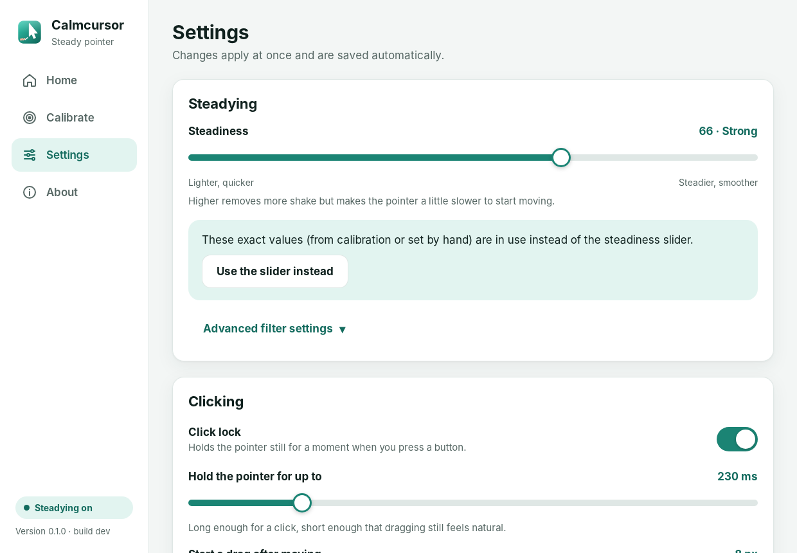
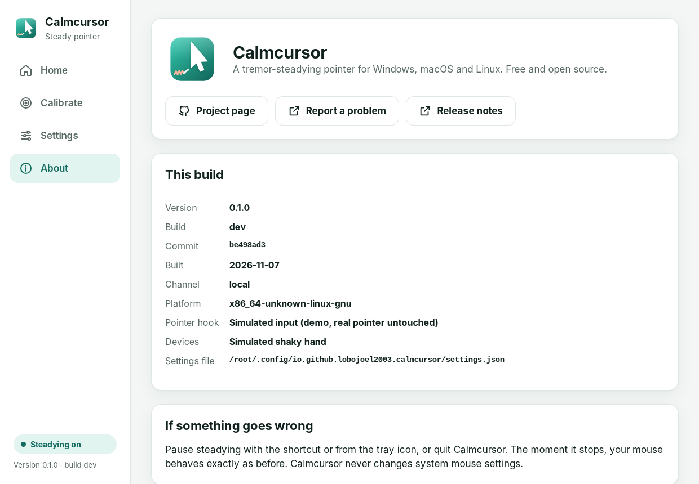
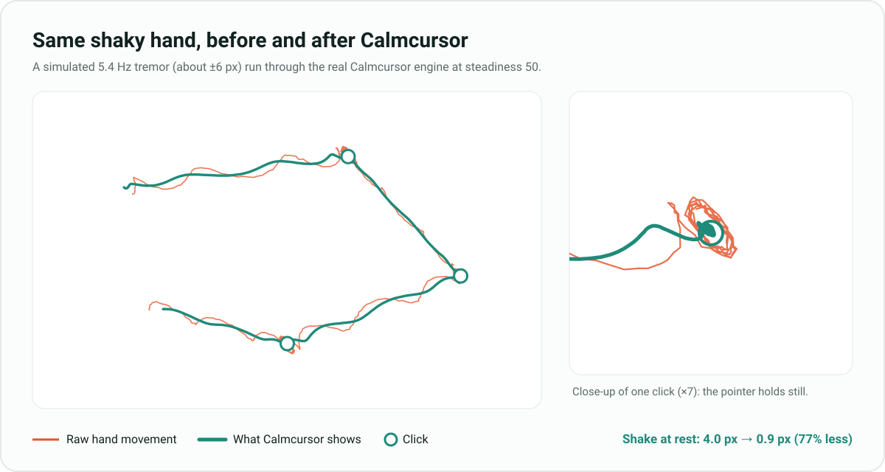
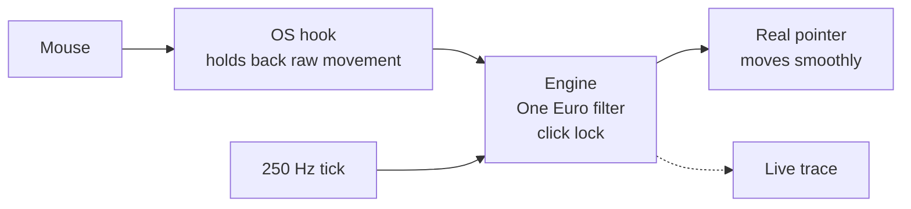

<div align="center">



# Calmcursor

**A tremor-steadying mouse pointer for Windows, macOS and Linux.**

Calmcursor smooths out the shake from Parkinson's disease, essential tremor and
other hand tremors, so the pointer goes where you mean it to and clicks land on
the right thing. A 30-second game tunes it to your own hand. It's free and open source.

[](https://github.com/lobojoel2003/Calmcursor/actions/workflows/ci.yml)
[](https://github.com/lobojoel2003/Calmcursor/releases/latest)
[](LICENSE)


[**Download**](https://github.com/lobojoel2003/Calmcursor/releases/latest) ·
[Install](#install) ·
[How it works](#how-it-works) ·
[Build from source](#build-from-source)

<br>



</div>

## Why Calmcursor

Hand tremor makes the pointer jump and clicks land on the wrong thing. Many
people give up on computers they otherwise need. On the
[Parkinson's UK forum](https://forum.parkinsons.org.uk/t/use-of-a-computer-mouse-with-pd/30281),
people trade workarounds such as trackballs, weighted cuffs and switching hands.

The best-known software fix, [SteadyMouse](https://www.steadymouse.com/), works
only on Windows and is paid. Its free original "hasn't been updated since 2006
and won't work on recent versions of Windows"
([Parkinson's UK Tech Guide](https://techguide.parkinsons.org.uk/catalogue/SteadyMouse)).
On GitHub there were only tiny experiments, and nothing for Mac or Linux.

Calmcursor is free, works on all three systems, and measures your tremor
to tune itself to you.

## What it does

<table>
<tr>
<td width="50%" valign="top">

### Steadies the pointer
An adaptive filter (the [One Euro filter](https://gery.casiez.net/1euro/))
removes the fast back-and-forth of a tremor but stays quick when you
deliberately move. It works in every app.

### Makes clicks land
**Click lock** holds the pointer still for a moment when you press a button,
so a shaky press doesn't slip off the target or turn into a drag. An optional
**double-press filter** ignores a second click your finger didn't mean.

</td>
<td width="50%" valign="top">

### Tunes itself to you
A **30-second calibration game** (rest, follow, tap) measures your tremor's
rhythm and size. It then tests 81 filter settings on your own movement and
picks the one with the least delay that still removes most of the shake.

### Shows you it's working
A **live trace** draws your hand's raw path next to the steadied pointer,
with a running "shake removed" meter. No mouse handy? Switch to the demo.

</td>
</tr>
</table>

Also: a tray/menu-bar icon, a pause shortcut (`Ctrl+Alt+Shift+S`, or `⌘⌥⇧S` on a Mac),
launch at login, and large, high-contrast controls throughout. Calmcursor makes
no network connections and collects nothing.

## See it

<table>
<tr>
<td width="50%"></td>
<td width="50%"></td>
</tr>
<tr>
<td align="center"><b>The calibration game.</b> Follow the dot while Calmcursor watches your natural movement.</td>
<td align="center"><b>Your results.</b> Your tremor, a replay of your path, and settings tuned to you.</td>
</tr>
<tr>
<td width="50%"></td>
<td width="50%"></td>
</tr>
<tr>
<td align="center"><b>Settings</b> in plain words, with advanced filter controls tucked away.</td>
<td align="center"><b>About</b> shows the exact version, build number and commit.</td>
</tr>
</table>

<p align="center">

</p>

<sub>These screenshots come from the real app running on Linux with its built-in
simulated input (`CALMCURSOR_BACKEND=simulated`). The calibration was played
by a script with a synthetic 5.2 Hz tremor. The chart above is drawn by
`calmcursor-cli simulate`, using the same engine.</sub>

## Install

Download the file for your system from the
[**latest release**](https://github.com/lobojoel2003/Calmcursor/releases/latest).

| System | File | Notes |
|---|---|---|
| **Windows 10/11** | `Calmcursor_x.y.z_x64-setup.exe` (recommended) or `…_x64_en-US.msi` | If SmartScreen appears, choose **More info → Run anyway**. |
| **macOS 10.15+** (Apple silicon and Intel) | `Calmcursor_x.y.z_universal.dmg` | Drag to Applications. The first time, right-click the app and choose **Open**. |
| **Ubuntu, Debian, Mint, Pop!_OS** | `Calmcursor_x.y.z_amd64.deb` | `sudo apt install ./Calmcursor_*.deb` |
| **Fedora, openSUSE, RHEL** | `Calmcursor-x.y.z-1.x86_64.rpm` | `sudo dnf install ./Calmcursor-*.rpm` |
| **Any Linux** | `Calmcursor_x.y.z_amd64.AppImage` | Make it executable and run it. Needs the [permission step](#linux-permissions). |
| **Command line** | `calmcursor-cli-x.y.z-<system>.tar.gz` / `.zip` | Headless steadying. See [below](#command-line-tool). |

Every release includes `SHA256SUMS.txt` so you can verify downloads.

### One-time permission

**Windows** needs nothing extra.

**macOS** needs Accessibility access to steady the pointer. Calmcursor asks on
first launch. You can also open **System Settings → Privacy & Security →
Accessibility** and switch Calmcursor on. After an update, macOS may ask
again.

<a id="linux-permissions"></a>
**Linux** needs to read your mouse and create a virtual pointer. The `.deb` and
`.rpm` packages set this up automatically (log out and back in once). For the
AppImage or a source build, install the udev rule:

```bash
sudo cp packaging/linux/70-calmcursor.rules /etc/udev/rules.d/
sudo modprobe uinput
sudo udevadm control --reload-rules && sudo udevadm trigger
```

The rule uses `uaccess`, so only the person logged in at the computer gets
access, and only while they are logged in. Calmcursor works on X11 and on every
Wayland desktop (GNOME, KDE Plasma, Sway and others). It steadies mice and
trackballs. Touchpads and drawing tablets are not supported yet.

## Using it

1. **Open Calmcursor.** Steadying turns on straight away with balanced
   settings.
2. **Calibrate** (recommended). Click **Calibrate → Start** and play the
   30-second game. Then press **Use these settings**.
3. **Adjust if you like.** Move the **Steadiness** slider: higher removes more
   shake, lower feels quicker.
4. **Close the window.** Calmcursor keeps working from the tray or menu bar.

If the pointer ever feels wrong, press the pause shortcut or choose **Quit**
from the tray icon. The moment Calmcursor stops, your mouse behaves exactly as
before.

## How it works



The **One Euro filter** is a low-pass filter whose cutoff rises with speed:
`cutoff = min_cutoff + beta × speed`. When your hand is nearly still the cutoff
is far below tremor frequencies (4–12 Hz), so the shake disappears. When you
move on purpose it opens up, so the pointer keeps up. The speed estimate is
smoothed too, so the tremor itself barely loosens the filter.

| | Windows | macOS | Linux |
|---|---|---|---|
| Intercepts movement with | low-level mouse hook (`WH_MOUSE_LL`) | Quartz event tap (`CGEventTap`) | `evdev` exclusive grab |
| Moves the pointer with | `SetCursorPos` | rewritten and posted `CGEvent`s | `uinput` virtual pointer |

The core is written in Rust for low latency and is shared by all three
systems. The settings app is built with [Tauri](https://tauri.app/). Read
[docs/ARCHITECTURE.md](docs/ARCHITECTURE.md) for the details: threads,
calibration maths, and how each OS backend fails safe.

## Command-line tool

`calmcursor-cli` steadies the pointer without the window, using the same settings file:

```bash
calmcursor-cli run                    # steady until Ctrl+C
calmcursor-cli run --steadiness 70    # try a different strength
calmcursor-cli status                 # permissions, backend, settings path
calmcursor-cli simulate --svg out.svg # draw a before/after chart
calmcursor-cli --version              # version, build number and commit
```

## Build from source

You need [Rust](https://rustup.rs/) (stable) and [Node.js](https://nodejs.org/) 20+.
On Linux, first install:

```bash
sudo apt-get install libwebkit2gtk-4.1-dev libgtk-3-dev libayatana-appindicator3-dev librsvg2-dev libxdo-dev libssl-dev
```

Then:

```bash
git clone https://github.com/lobojoel2003/Calmcursor.git
cd Calmcursor/app
npm install
npm run tauri dev      # run the app
npm run tauri build    # make an installer for your system
```

To try it without touching your real pointer, use the simulated input:

```bash
CALMCURSOR_BACKEND=simulated npm run tauri dev
```

Run the tests with `cargo test --workspace`. The steadying engine, filter,
tremor analysis and calibration all have unit tests driven by a simulated
shaky hand.

### Project layout

```text
crates/calmcursor-core       filter, engine, click lock, tremor analysis, calibration (no OS code)
crates/calmcursor-platform   Windows / macOS / Linux hooks and the tick thread
crates/calmcursor-cli        the command-line tool
app/                         desktop app: Tauri (src-tauri) + TypeScript UI (src)
packaging/linux              udev rule and install scripts
scripts/version.py           version checks, bumps and release notes
```

## Versions and releases

Calmcursor uses [semantic versioning](https://semver.org/). Every release has a
`vX.Y.Z` git tag, and every build carries a **build number** (the CI run
number) and its git commit. You can see both in **About** and in
`calmcursor-cli --version`. Pushing a tag builds and publishes all the
installers automatically. See [docs/RELEASING.md](docs/RELEASING.md) and the
[changelog](CHANGELOG.md).

## Contributing

Bug reports and ideas are very welcome, especially from people who live with
tremor or support someone who does. See [CONTRIBUTING.md](CONTRIBUTING.md).

## Important

Calmcursor is an everyday accessibility aid, not a medical device. Its tremor
measurements are for tuning only and are not a diagnosis.

## License

[GNU General Public License v3.0 or later](LICENSE).

The smoothing is based on *1€ Filter: A Simple Speed-based Low-pass Filter for
Noisy Input in Interactive Systems* by Géry Casiez, Nicolas Roussel and Daniel
Vogel (CHI 2012).
