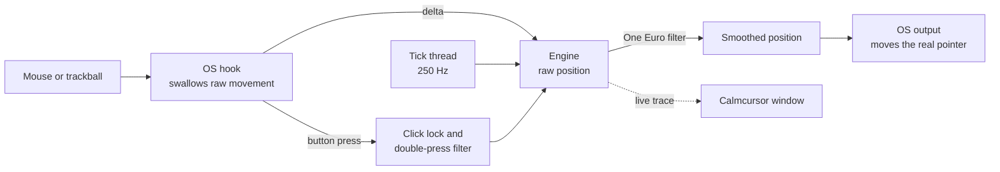
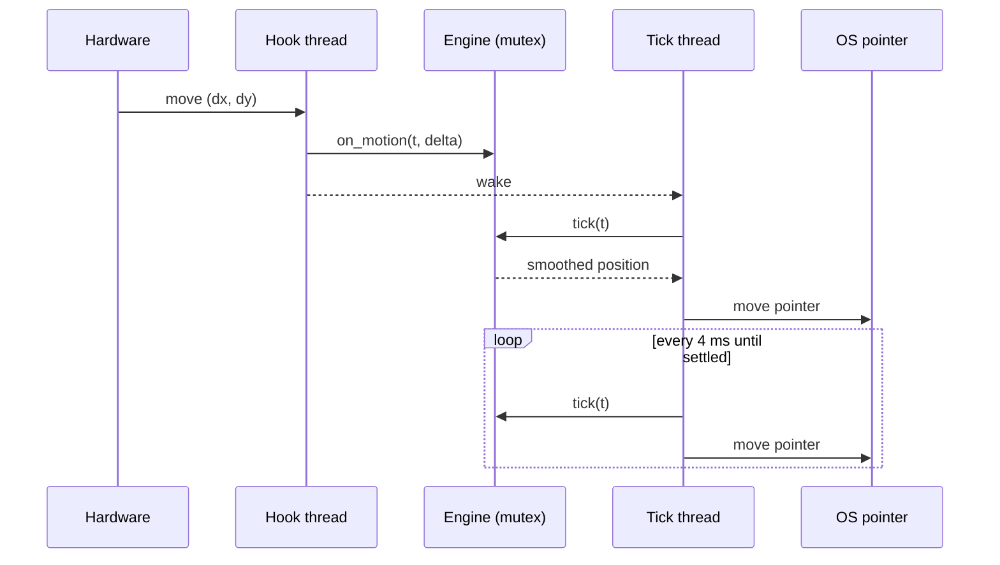

# How Calmcursor works

## The pipeline



1. **Intercept.** The OS hook sees each hardware movement before the pointer
   moves, records the movement as a delta, and stops the original from
   reaching the screen.
2. **Track the raw position.** The engine adds the delta to a "raw" position:
   where the pointer would be without Calmcursor.
3. **Filter.** A tick thread runs the One Euro filter on the raw position,
   once per input event and at a steady 250 Hz in between, so the pointer
   glides to rest after the hand stops instead of freezing mid-way.
4. **Apply.** The smoothed position is applied to the real pointer.

The engine (`crates/calmcursor-core/src/engine.rs`) has no OS code at all.
Time is passed in as plain seconds, which keeps it deterministic and makes
every behaviour unit-testable.

## The filter

Calmcursor uses the One Euro filter (Casiez, Roussel and Vogel, CHI 2012), a
first-order low-pass filter whose cutoff rises with speed:

```text
cutoff = min_cutoff + beta × |speed|
```

- When the hand is nearly still, the cutoff sits at `min_cutoff` (0.3–3 Hz),
  well below the 4–12 Hz of Parkinsonian and essential tremor, so the shake
  is filtered out.
- During a deliberate move the speed rises, the cutoff opens up, and the
  pointer keeps up.
- The speed estimate is itself low-pass filtered at `d_cutoff` (1 Hz). Tremor
  is fast but goes back and forth, so it barely raises the speed estimate.
  This is what makes One Euro a good fit for tremor.

Calmcursor filters x and y together with one shared cutoff driven by the 2D
speed, so diagonal moves behave the same as straight ones.

The **Steadiness** slider (0–100) maps to `min_cutoff` from 3 Hz to 0.3 Hz
and `beta` from 0.02 to 0.002, both on a log scale.

## Click lock and the double-press filter

When a button goes down, the engine pins the pointer where it is. The pin is
released when either:

- the hand has moved further than the drag radius (default 10 px), meaning
  the person is dragging; or
- the hold time has passed (default 250 ms).

The filter then restarts from the pinned spot, so the pointer glides on
instead of jumping. Both the press and a quick release land on the same
pixel, and a second click of a double-click usually does too.

The optional double-press filter drops a press that arrives within a few
milliseconds of the previous release of the same button, along with its
matching release.

## Calibration

The game (`app/src/game.ts`) records three rounds with steadying paused:

| Round | Records | Used for |
|---|---|---|
| Rest (≈10 s) | pointer held in a circle | tremor frequency and size at rest |
| Follow (12 s) | pointer following a gliding dot | tremor while moving, and how much lag is acceptable |
| Tap (6 clicks) | press and release positions and times | click lock radius and time, double-press filter |

`crates/calmcursor-core/src/calibration.rs` then:

1. resamples the recordings to 120 Hz;
2. splits each one into a slow trend (zero-phase 2 Hz Butterworth) and the
   fast residual, which is the tremor;
3. finds the dominant frequency between 3 and 12 Hz with a windowed DFT and
   measures its size;
4. runs a grid of 81 filter settings over the person's own recordings, keeps
   the ones that remove at least 85% of the shake at rest and 55% while moving,
   and from those picks the one that follows the deliberate movement most
   closely, which means the least lag;
5. sets click lock from how far and how long their presses drifted.

## Operating systems

| | Windows | macOS | Linux |
|---|---|---|---|
| Intercept | `WH_MOUSE_LL` low-level mouse hook | Quartz event tap at the HID level | exclusive `EVIOCGRAB` on each mouse |
| Raw delta | hook's position minus `GetCursorPos` | the event's delta fields | `REL_X` / `REL_Y` |
| Apply | `SetCursorPos` | rewrites the event, plus tagged synthetic events | a `uinput` virtual pointer |
| Permission | none | Accessibility | read `/dev/input`, write `/dev/uinput` (udev rule) |
| Display servers | n/a | n/a | X11 and every Wayland compositor |

Notes:

- **Windows.** Moves injected by other software (remote desktop, automation)
  pass through untouched and the engine re-centres on them. Windows refuses
  to let a normal process move the pointer over an elevated window; when
  that happens Calmcursor passes movement through until it is allowed again,
  so the pointer never freezes. The timer resolution is raised to 1 ms while
  steadying so 250 Hz ticks are on time.
- **macOS.** The tap rewrites each hardware move with the smoothed position,
  and button events are moved there too, so clicks land where the pointer is
  drawn. Drawing tablets (absolute input) pass through untouched. If another
  app warps the pointer, the engine re-centres on the new position.
- **Linux.** The virtual pointer is created before any device is grabbed,
  so a failure can never leave the real mouse dead. Wheel events are
  forwarded with hi-res values so smooth scrolling keeps working. Devices
  that also send keyboard keys, touchpads, and tablets are left alone.
  Hot-plugged mice are picked up every two seconds.

On every OS, if Calmcursor exits or crashes, the OS drops the hook, tap or
grab, and the pointer works normally again.

## Threads



When nothing is moving and the pointer has settled, the tick thread sleeps,
so Calmcursor uses no CPU at rest.

## The desktop app

- `app/src-tauri` hosts the steadier, a tray/menu-bar icon, the global pause
  shortcut, launch at login and single-instance handling. Closing the window
  keeps steadying running in the background.
- `app/src` is a framework-free TypeScript UI. Every control is large and
  there is nothing that needs a double-click or precise dragging.
- The live trace streams `[t, raw x, raw y, smoothed x, smoothed y, flags]`
  samples from the engine about 30 times a second while the window is open.

## Settings

Stored as JSON in the user's config folder
(`<config>/io.github.lobojoel2003.calmcursor/settings.json`). Every field has
a default and unknown fields are ignored, so files from older and newer
versions load. A damaged file is kept as `settings.json.bad` and defaults are
used.
